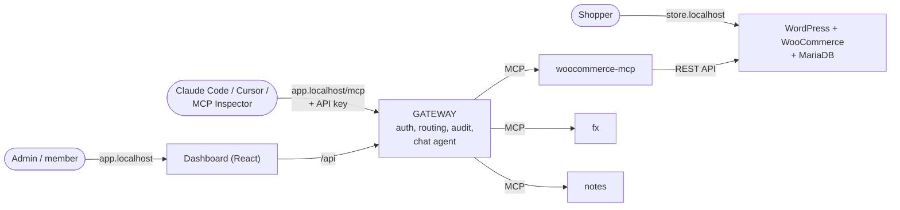

# WooCommerce hosting with a Team MCP Gateway on Kubernetes

A WooCommerce store on Kubernetes, an MCP server we wrote for it, and a **team MCP gateway**: an admin registers MCP servers once, and every team member then uses all of their tools through **one URL and one personal API key**, either from an MCP client (Claude Code, Cursor, MCP Inspector) or from a chat agent in the dashboard. Everything is deployed with Helm and runs on local Kubernetes (k3d) and, with different values only, on a k3s VPS.



**Rule:** nothing except the gateway talks to an upstream MCP server. The upstreams are ClusterIP-only and a NetworkPolicy allows only the gateway to call them.

## Contents

1. [What works today](#what-works-today)
2. [Documentation map](#documentation-map)
3. [Repository layout](#repository-layout)
4. [Quick start (local)](#quick-start-local)
5. [The WooCommerce MCP server: how it talks to the store](#the-woocommerce-mcp-server-how-it-talks-to-the-store)
6. [Place an order](#place-an-order)
7. [Try it: the demo flow](#try-it-the-demo-flow)
8. [Connect an external MCP client](#connect-an-external-mcp-client)
9. [Use the chat agent](#use-the-chat-agent)
10. [Production-like setup (k3s VPS)](#production-like-setup-k3s-vps)
11. [Upgrade and rollback](#upgrade-and-rollback)
12. [Kubernetes at a glance](#kubernetes-at-a-glance)
13. [Security in short](#security-in-short)
14. [Stand-out items attempted](#stand-out-items-attempted)
15. [Known limitations](#known-limitations)

## What works today

| Area | State |
|---|---|
| Store (WordPress, WooCommerce, MariaDB, PVCs, Ingress, probes, limits) | Done, running in k3d |
| WooCommerce MCP server (5 tools, REST + OAuth1) | Done, running, internal-only |
| Two more upstreams: `fx`, `notes` | Done, running |
| Gateway: registry, aggregation, `<slug>__<tool>` naming, timeouts, hashed keys, roles, audit log, SSRF guard, encrypted credentials | Done, running |
| Dashboard: Chat, Servers, Team, My keys, Audit log | Done, running |
| Chat agent (tool loop, acts as the logged-in user) | Done, needs an LLM key (see below) |
| NetworkPolicies, default-deny, 24 automated checks | Done |
| Helm values for local and prod | Written; **VPS deployment not run yet** |
| External MCP client (Claude Code, Cursor, MCP Inspector) | Verified with **MCP Inspector** (list tools, call a tool, a wrong key is rejected). Claude Code and Cursor use the same URL and header |
| Per-tool permissions, multi-store provisioning, OAuth, metrics, scaling | Not built |
| Demo video | TODO |

## Documentation map

| Document | What it explains |
|---|---|
| [docs/architecture/README.md](docs/architecture/README.md) | **Complete system architecture**, diagrams, flows, data and secrets |
| [Phase 1: Store](docs/architecture/phase-1-store.md) | WordPress, MariaDB, PVCs, setup Job, probes |
| [Phase 2: WooCommerce MCP](docs/architecture/phase-2-woocommerce-mcp.md) | Tools, why REST, OAuth1 signing |
| [Phase 3: Gateway](docs/architecture/phase-3-gateway.md) | Aggregation, collisions, timeouts, keys, audit, SSRF |
| [Phase 4: Dashboard](docs/architecture/phase-4-dashboard.md) | Pages, same-origin design, nginx, CSP |
| [Phase 5: Chat agent](docs/architecture/phase-5-chat-agent.md) | The tool loop and acting as the user |
| [Phase 6: Network security](docs/architecture/phase-6-network-security.md) | NetworkPolicies and hardening |
| [Phase 7: Local to prod](docs/architecture/phase-7-local-to-prod.md) | Values diff, VPS steps, upgrade and rollback |
| [docs/DESIGN.md](docs/DESIGN.md) | **System design and tradeoffs** (assignment deliverable) |
| [docs/THREAT-MODEL.md](docs/THREAT-MODEL.md) | **Threat model** (assignment deliverable) |

## Repository layout

```
charts/store/             Helm: MariaDB, WordPress/WooCommerce, Ingress, wp-setup Job   (values-local / values-prod)
charts/mcp-woocommerce/   Helm: WooCommerce MCP server (ClusterIP only)                          (values-local / values-prod)
charts/mcp-servers/       Helm: the fx and notes demo MCP servers                               (values-local / values-prod)
charts/gateway/           Helm: gateway (Deployment, Service, PVC, Ingress for /mcp and /api)   (values-local / values-prod)
charts/dashboard/         Helm: dashboard (Deployment, Service, Ingress for /)                  (values-local / values-prod)
charts/network-policies/  Helm: default-deny + one allow policy per workload                    (values-local / values-prod)
mcp-woocommerce/          WooCommerce MCP server source (TypeScript) + Dockerfile
mcp-servers/              fx and notes MCP servers (one image) + Dockerfile
gateway/                  Gateway backend and chat agent (TypeScript, SQLite) + Dockerfile
dashboard/                React dashboard (Vite) + nginx Dockerfile
scripts/                  create-secrets.sh, set-llm-key.sh, netpol-check.sh
docs/                     architecture/, DESIGN.md (design and tradeoffs), THREAT-MODEL.md
```

## Quick start (local)

### Prerequisites

Docker, `kubectl`, `helm`, `k3d`, `openssl`. On Windows use WSL2 (Ubuntu) with Docker Desktop's WSL integration, and keep the repo on the Linux filesystem (for example `~/urumi`), not under `/mnt/c`.

### 1. Cluster

k3d runs k3s in Docker and maps ports 80 and 443 to Traefik (the Ingress controller built into k3s).

```sh
k3d cluster create urumi -p "80:80@loadbalancer" -p "443:443@loadbalancer"
```

**Local domains:** `store.localhost` and `app.localhost` resolve to `127.0.0.1` in modern browsers, so no `/etc/hosts` edit is needed. Traefik picks the route by `Host` header. If a tool cannot resolve `*.localhost`, add `127.0.0.1 store.localhost app.localhost` to your hosts file.

### 2. Secrets (never committed, never in values files)

```sh
scripts/create-secrets.sh urumi
```

Creates the namespace and random, idempotent Secrets: `mariadb-credentials`, `wordpress-admin`, `gateway-secrets` (`enc-key`, `bootstrap-admin-key`). Existing Secrets are left unchanged.

### 3. Store

```sh
helm install store charts/store -n urumi -f charts/store/values-local.yaml
kubectl get pods -n urumi              # mariadb-0 and wordpress become Ready
kubectl logs job/wp-setup -n urumi     # ends with "setup done"
```

### 4. WooCommerce REST key (manual, once)

Open `http://store.localhost/wp-admin` (user `urumi-admin`; password via `kubectl get secret wordpress-admin -n urumi -o jsonpath='{.data.password}' | base64 -d`). Go to WooCommerce, Settings, Advanced, REST API, Add key, with Read/Write permissions. The secret is shown once:

```sh
read -p "Consumer key: " WC_KEY
read -s -p "Consumer secret: " WC_SECRET; echo
kubectl create secret generic woocommerce-api-keys -n urumi \
  --from-literal=consumer-key="$WC_KEY" --from-literal=consumer-secret="$WC_SECRET"
unset WC_KEY WC_SECRET
```

### 5. Build and install the MCP servers

```sh
docker build -t woocommerce-mcp:0.1.2 mcp-woocommerce/ && k3d image import woocommerce-mcp:0.1.2 -c urumi
helm install mcp charts/mcp-woocommerce -n urumi -f charts/mcp-woocommerce/values-local.yaml

docker build -t mcp-servers:0.1.0 mcp-servers/ && k3d image import mcp-servers:0.1.0 -c urumi
helm install mcp-servers charts/mcp-servers -n urumi -f charts/mcp-servers/values-local.yaml
```

`k3d image import` is needed because the cluster cannot see images that exist only in your local Docker.

### 6. Gateway and dashboard

Install the gateway **after** the MCP servers: on its first start it registers `woo`, `fx` and `notes` (the seeded servers) and needs their Service names to resolve.

```sh
docker build -t gateway:0.1.3 gateway/ && k3d image import gateway:0.1.3 -c urumi
helm install gateway charts/gateway -n urumi -f charts/gateway/values-local.yaml

docker build -t dashboard:0.1.0 dashboard/ && k3d image import dashboard:0.1.0 -c urumi
helm install dashboard charts/dashboard -n urumi -f charts/dashboard/values-local.yaml
```

Open **http://app.localhost** and sign in with the first admin's key:

```sh
kubectl get secret gateway-secrets -n urumi -o jsonpath='{.data.bootstrap-admin-key}' | base64 -d; echo
```

### 7. Network policies (last)

```sh
helm install netpol charts/network-policies -n urumi -f charts/network-policies/values-local.yaml
scripts/netpol-check.sh urumi          # expect: 24 passed, 0 failed
```

### 8. Chat agent key (optional until you want chat)

```sh
export GEMINI_API_KEY=...              # free key from Google AI Studio
scripts/set-llm-key.sh urumi
kubectl rollout restart deploy/gateway -n urumi
```

### Check everything is up

```sh
kubectl get pods,svc,ingress,pvc -n urumi
helm ls -n urumi                       # store, mcp, mcp-servers, gateway, dashboard, netpol
```

## The WooCommerce MCP server: how it talks to the store

`mcp-woocommerce/` is an MCP server written for this project (TypeScript, Streamable HTTP at `/mcp`) with five tools: `list_products`, `create_product`, `list_orders` (filter by status and date), `get_order`, `update_order_status`. It is a ClusterIP Service with no Ingress, and a NetworkPolicy lets only the gateway call it.

**It talks to the store through the WooCommerce REST API** (`/wp-json/wc/v3`), with a consumer key and secret created in WooCommerce. Why:

- It is the official interface: WooCommerce still runs its own logic (stock, order status hooks, validation). **WP-CLI** would need exec access into the WordPress pod (a broad Kubernetes permission) and tie the server to that pod; **direct SQL** would bypass WooCommerce's rules.
- The key belongs to a user and has a permission level, so the server never needs the admin password, and the key can be revoked in WooCommerce.
- Over plain HTTP (pod to pod) WooCommerce requires **OAuth 1.0a** request signing, so the server signs each request (the secret never travels). The signature is computed for the store's public address (`woocommerce.siteUrl`), while the request goes to the in-cluster Service (`woocommerce.baseUrl`).

More: [Phase 2](docs/architecture/phase-2-woocommerce-mcp.md).

## Place an order

1. Open **http://store.localhost/shop** (a private window is fine, no login needed).
2. Add **Sample T-Shirt** to the cart and go to checkout.
3. Fill in test details and choose **Cash on delivery** (enabled by the setup Job), then place the order.
4. Open **http://store.localhost/wp-admin** (user `urumi-admin`), then **WooCommerce, Orders**: the order is listed as **Processing**.

No order emails are sent (no SMTP server in the cluster).

## Try it: the demo flow

This mirrors the assignment's definition of done. Create two users first: sign in as admin, **Team**, invite `user-a@example.com` and `user-b@example.com`. Each invite shows that user's first API key **once**: copy it.

| # | Step | Expected |
|---|---|---|
| 1 | Open `http://store.localhost/shop` in a private window, add **Sample T-Shirt**, check out with **Cash on delivery** | Order placed |
| 2 | WooCommerce admin, WooCommerce, Orders | The order is listed as Processing |
| 3 | Dashboard, **Servers** | `woo`, `fx`, `notes` are **Connected**, each with its tools |
| 4 | Sign in as **user A**, Chat: *"Create a product called Blue Mug priced 12.50 and publish it"* | `woo__create_product` shown under "Used 1 tool"; product visible at `/shop` |
| 5 | Buy it on the storefront, then in chat: *"What orders came in today?"* | `woo__list_orders` returns the order |
| 6 | Connect an MCP client as **user B** (next section), list tools | Tools of every enabled server, prefixed |
| 7 | As user B: *"What orders came in today?"* | Same answer through `woo__list_orders` |
| 8 | As user B, in the external client: a two-server prompt, *"What is the total of today's orders in INR? Save a note with the summary."* | Uses `woo__list_orders`, `fx__convert_currency`, `notes__create_note` |
| 9 | Admin, Team: **revoke user B's key** | User B's next call fails with `401` |
| 10 | Admin, Servers: **disable** `fx` | Its tools vanish from chat and from the client's list |
| 11 | `kubectl delete pod -l app=mcp-notes -n urumi` (or scale a server to 0) | `notes` shows **Unreachable** with a reason; other servers keep working |
| 12 | Admin, **Audit log** | Every call above, attributed to the right user (A, B), with server, tool, time, duration, outcome |

## Connect an external MCP client

You need only the **gateway URL** and **your own API key** (create one under **My keys**, or take the one from your invite). You never configure an upstream server or see its credentials.

- URL: `http://app.localhost/mcp` (local) or `https://app.<your-domain>/mcp`
- Header: `Authorization: Bearer <your key>`

```sh
# Claude Code
claude mcp add --transport http gateway http://app.localhost/mcp \
  --header "Authorization: Bearer <your key>"

# MCP Inspector: choose transport "Streamable HTTP", same URL, add the same header
npx @modelcontextprotocol/inspector
```

Cursor: add an HTTP MCP server with the same URL and `Authorization` header in its MCP settings. Quick sanity check without a client:

```sh
curl -s -o /dev/null -w '%{http_code}\n' -H "Host: app.localhost" http://localhost/mcp     # 401 without a key
```

**Name resolution:** browsers resolve `*.localhost` by themselves, but command-line tools (Claude Code, Inspector, `curl` in WSL) often do not. Either add `127.0.0.1 app.localhost` to your hosts file (`/etc/hosts`, and the Windows hosts file for Windows apps), or skip DNS with a port-forward and use `http://localhost:8081/mcp`:

```sh
kubectl port-forward svc/gateway 8081:80 -n urumi
```

**Verified with MCP Inspector's CLI:**

```sh
URL=http://localhost:8081/mcp
npx @modelcontextprotocol/inspector --cli $URL --transport http --method tools/list \
  --header "Authorization: Bearer $KEY"                       # every enabled server's tools, prefixed
npx @modelcontextprotocol/inspector --cli $URL --transport http --method tools/call \
  --tool-name woo__list_orders --tool-arg after=2026-10-18 --header "Authorization: Bearer $KEY"
```

A wrong or revoked key is rejected (`401`; Inspector reports it as `auth_required`). The same URL and `Authorization` header are all Claude Code and Cursor need.

## Use the chat agent

Dashboard, **Chat** tab (the default). Ask a question; the agent lists the tools of all enabled servers, lets the model call them, and shows **"Used N tools"** under each answer with arguments, duration and result preview. Calls run **as you**, so the audit log shows your email. API form:

```sh
curl -s -H "Host: app.localhost" -H "Authorization: Bearer $KEY" -H "content-type: application/json" \
  -d '{"messages":[{"role":"user","content":"Which products does the store sell?"}]}' \
  http://localhost/api/chat
```

Provider: any OpenAI-compatible API (default Gemini `gemini-3.5-flash-lite`; change `llm.baseUrl` and `llm.model` in `charts/gateway/values.yaml`). Free tiers have daily limits; each tool round trip costs one model call. Without a key, chat answers `503` and everything else works. Details: [Phase 5](docs/architecture/phase-5-chat-agent.md).

## Production-like setup (k3s VPS)

The same charts run on a single-node k3s VPS: **only Helm values change** (each chart has a `values-prod.yaml`). **This has not been run on a real VPS yet**; the values render and lint, and the steps below follow the local flow. Details: [Phase 7](docs/architecture/phase-7-local-to-prod.md).

| What changes | Local (`values-local.yaml`) | VPS (`values-prod.yaml`) |
|---|---|---|
| Hostnames | `store.localhost`, `app.localhost` | `store.<domain>`, `app.<domain>` (DNS A records to the VPS) |
| Ingress / TLS | Traefik, HTTP | Traefik + cert-manager (`ClusterIssuer letsencrypt`), HTTPS (`ingress.scheme`, `ingress.tls`, annotations) |
| Images | built locally, `k3d image import` | pushed to a registry, `image.repository` |
| Storage | `local-path`, 1-2Gi | larger sizes, optional `persistence.storageClass` |
| Resources | small | larger requests and limits |
| Secrets | `scripts/create-secrets.sh` | same script now; an external secret manager later |
| OAuth signing URL | `http://store.localhost` | `https://store.<domain>` (`woocommerce.siteUrl` in `charts/mcp-woocommerce`) |

**1. Prepare.** An Ubuntu VPS, a domain, DNS A records for `store.<domain>` and `app.<domain>` pointing to the VPS, and the firewall open for 22, 80 and 443.

**2. Install k3s and Helm** (k3s ships Traefik and the `local-path` storage class):

```sh
curl -sfL https://get.k3s.io | sh -
mkdir -p ~/.kube && sudo cp /etc/rancher/k3s/k3s.yaml ~/.kube/config && sudo chown $USER ~/.kube/config
curl -fsSL https://raw.githubusercontent.com/helm/helm/main/scripts/get-helm-3 | bash
```

**3. Set your domain and registry** in the values files (hosts and images are the only things to edit):

```sh
sed -i 's/store\.example\.com/store.<domain>/g; s/app\.example\.com/app.<domain>/g' charts/*/values-prod.yaml
sed -i 's#registry\.example\.com/urumi#<your-registry>/urumi#g' charts/*/values-prod.yaml
```

Build and push the four images (`woocommerce-mcp`, `mcp-servers`, `gateway`, `dashboard`) to that registry. On a single VPS you can skip the registry: build on the VPS, run `docker save <image> | sudo k3s ctr images import -`, and install with `--set image.repository=<image name>`.

**4. TLS (optional but recommended)**, cert-manager with Let's Encrypt (see cert-manager's docs for the current install flags):

```sh
helm repo add jetstack https://charts.jetstack.io && helm repo update
helm install cert-manager jetstack/cert-manager -n cert-manager --create-namespace --set crds.enabled=true
kubectl apply -f - <<'EOF'
apiVersion: cert-manager.io/v1
kind: ClusterIssuer
metadata: { name: letsencrypt }
spec:
  acme:
    server: https://acme-v02.api.letsencrypt.org/directory
    email: you@<domain>
    privateKeySecretRef: { name: letsencrypt-account-key }
    solvers: [ { http01: { ingress: { class: traefik } } } ]
EOF
```

Only the dashboard's Ingress asks cert-manager for the certificate; the gateway's Ingress reuses the same TLS Secret (`app-tls`). Two Ingresses must not both request one certificate.

**5. Secrets, then install in the same order as locally**, with the production values:

```sh
scripts/create-secrets.sh urumi
helm install store charts/store -n urumi -f charts/store/values-prod.yaml
# create the WooCommerce REST key at https://store.<domain>/wp-admin (step 4 of the local quick start)
helm install mcp         charts/mcp-woocommerce  -n urumi -f charts/mcp-woocommerce/values-prod.yaml
helm install mcp-servers charts/mcp-servers      -n urumi -f charts/mcp-servers/values-prod.yaml
helm install gateway     charts/gateway          -n urumi -f charts/gateway/values-prod.yaml
helm install dashboard   charts/dashboard        -n urumi -f charts/dashboard/values-prod.yaml
helm install netpol      charts/network-policies -n urumi -f charts/network-policies/values-prod.yaml
```

**6. Check.** Open `https://app.<domain>`, sign in with the admin key, and on the VPS run `STORE_HOST=store.<domain> APP_HOST=app.<domain> scripts/netpol-check.sh urumi` (the script sends those Host headers to the local Ingress).

## Upgrade and rollback

Each component is its own Helm release, so each is upgraded and rolled back on its own:

```sh
helm upgrade store charts/store -n urumi -f charts/store/values-local.yaml        # the wp-setup hook Job runs again
helm upgrade mcp charts/mcp-woocommerce -n urumi -f charts/mcp-woocommerce/values-local.yaml --set image.tag=<new>
helm upgrade gateway charts/gateway -n urumi -f charts/gateway/values-local.yaml --set image.tag=<new>
helm history gateway -n urumi
helm rollback gateway <revision> -n urumi
```

**Upgrade safely with `--atomic`:** if the new version does not become ready within the timeout, Helm rolls back by itself.

**Tested (dashboard):** an upgrade to an image tag that does not exist:

```sh
helm upgrade dashboard charts/dashboard -n urumi -f charts/dashboard/values-local.yaml \
  --set image.tag=does-not-exist --atomic --timeout 50s
# Error: UPGRADE FAILED: ... has been rolled back due to atomic being set
helm history dashboard -n urumi
#  1  superseded  Install complete
#  2  failed      Upgrade "dashboard" failed: context deadline exceeded
#  3  deployed    Rollback to 1
```

Kubernetes kept the old pod serving while the new one could not start: a client polling the site every 2 s during the failed upgrade got **45 of 45 HTTP 200** responses.

What to keep in mind:

- Rollback restores Kubernetes objects, **not data**. Back up MariaDB and the gateway's SQLite files (`gateway.db`, `-wal`, `-shm`) before a risky upgrade.
- The gateway uses the `Recreate` strategy (a few seconds of downtime) because SQLite allows one writer. After an upgrade the gateway kept its servers and users (they live on the PVC) and did not re-seed.
- A StatefulSet's `volumeClaimTemplates` and PVC specs are immutable, so storage size or class cannot be changed by an upgrade.
- Image and WooCommerce versions are pinned in values, so an upgrade is an explicit change.

## Kubernetes at a glance

Namespace `urumi`; six Helm releases.

| Workload | Kind | Storage | Exposure | Probes |
|---|---|---|---|---|
| mariadb | StatefulSet | PVC 2Gi | ClusterIP | TCP startup/readiness/liveness |
| wordpress | Deployment | PVC 2Gi | **Ingress** `store.localhost` | readiness `/wp-login.php`, liveness TCP |
| woocommerce-mcp | Deployment | none | ClusterIP, gateway-only | `/healthz` |
| mcp-fx, mcp-notes | Deployment | none | ClusterIP, gateway-only | `/healthz` |
| gateway | Deployment (Recreate) | PVC 1Gi (SQLite) | **Ingress** `app.localhost` `/mcp`, `/api` | startup+liveness `/healthz`, readiness `/readyz` |
| dashboard | Deployment | none | **Ingress** `app.localhost` `/` | `/healthz` |
| wp-setup | Job (Helm hook) | uses WP PVC | none | n/a |

Every container has CPU/memory requests and limits. Liveness probes never depend on another service, so a database or upstream outage does not restart healthy pods. Secrets live in Kubernetes Secrets only.

**Public:** the storefront, the dashboard, `/mcp` and `/api`. **Internal only:** MariaDB, the three MCP upstreams. Enforced by (1) ClusterIP + no Ingress and (2) default-deny NetworkPolicies, proven by `scripts/netpol-check.sh`.

## Security in short

- User API keys: 256-bit random, **SHA-256 hashed**, shown once, revocable (effective on the next request).
- Upstream credentials: **AES-256-GCM encrypted**, decrypted only inside the gateway, never returned by the API.
- **No token passthrough:** the user's key is never sent upstream.
- **SSRF guard** on every upstream URL (metadata and loopback always blocked; private hosts only via a deployer allowlist; redirects refused).
- Roles: admin (servers, members, keys, audit) vs member (tools, own keys), enforced by the API.
- Containers: non-root; read-only root FS and dropped capabilities on gateway, dashboard, fx, notes.
- Dashboard: strict CSP, no HTML injection.
- Biggest known gap: all members can call any tool with the shared upstream credential (no per-tool permissions yet).

Full analysis: [docs/THREAT-MODEL.md](docs/THREAT-MODEL.md).

## Stand-out items attempted

| Item | State | Where |
|---|---|---|
| Security hardening: SSRF protection | Done | `gateway/src/ssrf.ts` |
| Security hardening: credentials encrypted at rest | Done | `gateway/src/crypto.ts` |
| Security hardening: default-deny NetworkPolicies + automated checks | Done | `charts/network-policies/`, `scripts/netpol-check.sh` |
| Security hardening: non-root, read-only FS, dropped caps | Partial (gateway, dashboard, fx, notes) | `charts/*/templates/deployment.yaml` |
| Production VPS (k3s) + TLS with cert-manager | Values and templates written, **not run** | `charts/*/values-prod.yaml` |
| Upgrades and rollback | Documented and tested: a failed upgrade with `--atomic` rolled back by itself, with no downtime | [Upgrade and rollback](#upgrade-and-rollback), [Phase 7](docs/architecture/phase-7-local-to-prod.md) |
| Bonus multi-store provisioning, tool permissions, OAuth, many-tools search, hosted servers, scaling, metrics | Not attempted | n/a |

## Known limitations

- Gateway is a single replica with SQLite (`Recreate`); scaling out needs Postgres.
- No per-tool permissions, rate limits, metrics, or audit of admin actions.
- `notes` is in-memory; `fx` uses fixed demo rates.
- The WooCommerce REST key is created by hand.
- No TLS between pods; MariaDB and WordPress run with image defaults.
- After an upstream pod restarts, the first `tools/list` can briefly show it as Unreachable (cause not found; self-corrects).
- No SMTP, so no order emails.
